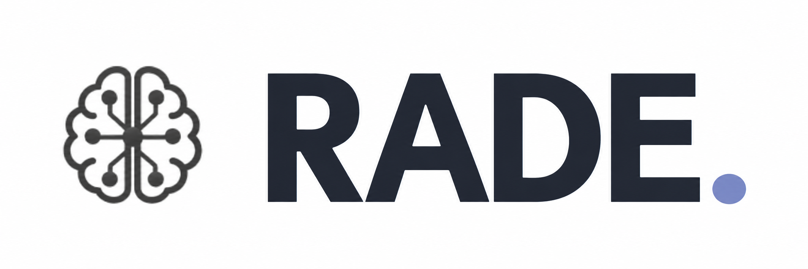

<div align="center">
  
  <br><br>
  <b>English</b> &middot; <a href="README.zh-CN.md">简体中文</a>
</div>

RADE is an open-source, lightweight personal agent application. It provides per-run file operations, session persistence, context management, long-term memory, plans, subagents, and Skill / Plugin / MCP extensibility, with a TUI and a GUI.

```text
TUI ───────────────────────── Bridge ── agent_runtime ── agent_core
RADE-server
├─ HTTP / WebSocket ── GUI
└─ Session Host ── Bridge ── agent_runtime ── agent_core
```

- `agent_core` provides frontend-agnostic agent mechanisms.
- `agent_runtime` reads application configuration and assembles the Core into a runnable instance.
- Bridge runs as a standalone process and is the only channel through which a frontend drives the Runtime.
- The TUI and GUI share execution and interaction semantics through the Bridge protocol. The Bridge subprocess channel uses newline-delimited JSON.

## Key capabilities

- **Direct local execution**: Shell and command Hooks run with the current user's host permissions and the run’s files directory as their working directory. Built-in file tools resolve paths within the run’s files directory.
- **A complete agent loop**: streaming responses, tool batches, context compaction, steer, cancel, plans, and background jobs.
- **Resumable sessions**: conversation and execution events are written to an append-only JSONL journal, and the TUI and GUI can read the same kind of session.
- **Memory** stores long-term context for each run.
- **Models** use Chat Completions or Responses through the OpenAI SDK. Subagents, context compression, and memory use the main agent’s selected provider.
- **Extension system**: standalone skills, skills / agents / MCP / [command hooks](docs/plugin-hooks.md) provided by plugins, and standalone MCP servers.
- **Two frontends** support interactive turns. The TUI suits terminal workflows. The GUI provides multi-session management, a run file tree, settings, and memory.

## Quick start

Requirements: Python >= 3.11, Node.js >= 22, and [uv](https://docs.astral.sh/uv/).

```bash
git clone https://github.com/EvannZhongg/B05_RADE.git
cd B05_RADE
npm install
npm run build
uv tool install --editable ".[server]"
```

To enable HTTP / WebSocket access in the project environment, install the server extra:

```bash
uv sync --extra server
```

Start the TUI from the project root.

```bash
RADE
```

The first launch initializes `.RADE/` in the project root. After quitting the TUI, create `.RADE/.env` and fill in the environment variables required by the default provider, for example:

```dotenv
DASHSCOPE_API_KEY=your-api-key
```

Then restart the TUI:

```bash
RADE
```

To start the GUI server, run

```bash
RADE-server
```

The GUI listens on <http://127.0.0.1:8736> by default.

Select a JSON scene from `input/` in the GUI or use `/input` in the TUI.
The `rethink` task evaluates the baseline, runs reflection, and saves the best
valid allocation to `output/rethink/` using the input filename.

`RADE-server` manages HTTP and the shared Session Host and Bridge. A configuration-directory process lock prevents duplicate servers.

## Module documentation

Third-party frontends can launch the installed `RADE-bridge` command and use the
[public stdio protocol](docs/bridge-protocol.md) or the lightweight
[`@rade/client` TypeScript SDK](interfaces/client/README.md).

Public contracts:

| Document | Scope |
| --- | --- |
| [`docs/bridge-protocol`](docs/bridge-protocol.md) | Stdio transport, commands, events, runtime phases, transcript checkpoints, and error rules for third-party clients |
| [`docs/bridge-api-design`](docs/bridge-api-design.md) | Which messages are public or internal, who owns them, and the versioning decisions |
| [`docs/plugin-hooks`](docs/plugin-hooks.md) | Command hook declarations, checkpoints, invocation payloads, and decisions |
| [`docs/plugin-interop`](docs/plugin-interop.md) | Assembly, static validation, error isolation, and re-assembly of plugin components |

Runtime layers:

| Document | Scope |
| --- | --- |
| [`agent_core`](agent_core/README.md) | Agent loop, context, session, tools, execution, memory, plans, jobs, providers, skills, and MCP mechanisms |
| [`agent_runtime`](agent_runtime/README.md) | Configuration, prompts, plugin discovery, runtime assembly, execution plane, session binding, and turn entry |

Frontends and SDK:

| Document | Scope |
| --- | --- |
| [`interfaces`](interfaces/README.md) | Shared host modules, launch entries, Bridge process and channel attachment, and the allowed Core reuse boundary |
| [`interfaces/bridge`](interfaces/bridge/README.md) | The standalone Bridge process, protocol routing, event translation, and frontend interaction forwarding |
| [`interfaces/protocol`](interfaces/protocol/README.md) | The TypeScript protocol package: exports, build, and change checklist |
| [`interfaces/client`](interfaces/client/README.md) | Public Node/TypeScript stdio client, process lifecycle and integration example |
| [`interfaces/tui`](interfaces/tui/README.md) | The Ink terminal interface, commands, input state, and Bridge subprocess attachment |
| [`interfaces/gui`](interfaces/gui/README.md) | The FastAPI service, React interface, multi-session connections, HTTP / WebSocket API, and run file browsing |

## Configuration and data

`agent_runtime` creates the configuration directory on first launch and is responsible for reading and updating the application configuration inside it:

| Path | Contents |
| --- | --- |
| `.RADE/provider_config.json` | Provider definitions and the default main agent provider |
| `.RADE/agent_config.json` | Tools, context, memory, subagents, and MCP |
| `.RADE/.env` | The secrets and environment variables referenced by the configuration |
| `.RADE/prompts/` | Main agent, subagent, compaction, and memory prompts |
| `.RADE/skills/` | Standalone skills |
| `.RADE/plugins/` | Plugin capability packages |
| `.RADE/AGENTS.md` | Application-wide runtime instructions |
| `.RADE/runs/<run_id>/` | Journal, run settings, memory, subagent records, and `files/` for scene snapshots, solver files, and tool artifacts |

The default configuration and built-in resources live in [`agent_runtime/defaults/`](agent_runtime/defaults). See [`agent_runtime/README.md`](agent_runtime/README.md) for how assembly works.

## Development and testing

Python tests use a mock provider and need no real API key:

```bash
python -m venv .venv
source .venv/bin/activate
python -m pip install -e ".[gui,test]"
python -m pytest --durations=20
```

On Windows, activate the environment with `.venv\Scripts\Activate.ps1`.

Pytest distributes test classes across four isolated worker processes. Use `-n 0` for a serial run or `-n 2` on smaller machines. The full suite includes package installation and real local MCP and shell processes; `--ignore=tests/test_bridge_client.py` omits the package installation check during iteration. The standalone plugin testkit has its own command in [docs/plugin-interop.md](docs/plugin-interop.md).

The server extra includes FastAPI, Uvicorn, and the WebSocket backend; Windows, macOS, and Linux use the same installation. The TUI runs with the base installation.

Frontend build, type checking, and tests:

```bash
npm run build
npm run typecheck
npm test
```


On Windows the shell tool uses PowerShell 7, so PowerShell 7 has to be installed separately.

## Contributors

- [AKArrok](https://github.com/AKArrok): reported and verified the append-only journal tail-append issue ([#2](https://github.com/EvannZhongg/Nosis/pull/2)).
- [George Pickett](https://github.com/georgeatparallel): contributed the Parallel Search MCP integration ([#4](https://github.com/EvannZhongg/Nosis/pull/4)).
- [Pocket99](https://github.com/Pocket99): contributed the initial GUI, with sessions, workspace browsing, and model switching ([#1](https://github.com/EvannZhongg/Nosis/pull/1)).

## License

[MIT](LICENSE)
